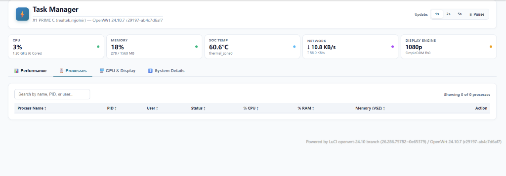

# luci-app-taskman

An advanced, interactive **Task Manager & System Hardware Monitor** for OpenWrt LuCI (compatible with OpenWrt 24.10+ / modern ucode backend).

## 📸 Screenshots

### Task Manager Dashboard & Process Monitor


---

## 🚀 Key Features

1. **Multi-Tab Dashboard**:
   - **Overview**: Instant health check with real-time CPU, RAM, Network, Storage, and System Temperature gauge bars.
   - **Performance Charts**: Live interactive charts with history tracking for CPU load, Memory allocation, and Swap usage.
   - **Processes**: Complete process viewer listing all running tasks with PID, User, CPU%, Memory%, Command, and a one-click **Kill Process** action.
   - **GPU & Display**: Dedicated hardware streaming monitor for HDMI / Video streamer (`fbstreamer`) with real-time Status indicator, Process PID tracking, and an interactive **Service Switch (ON / OFF / Autostart on boot)**.
2. **Zero Overhead Backend**:
   - Powered by lightweight `/usr/share/rpcd/ucode/luci.taskman` micro-service.
   - Direct kernel `/proc` inspection with no heavy external dependencies.
3. **Harmonious Material Design**:
   - Matches standard LuCI themes with responsive cards, badge pills, and dark/light mode compatibility.

## 📦 Installation

### Option 1: Install Pre-built IPK (Recommended)

1. Download the latest `.ipk` from [Releases](../../releases).
2. Install via command line or LuCI WebUI:
   ```sh
   opkg update
   opkg install luci-app-taskman_*.ipk
   ```
3. Access via LuCI menu: **Status** &rarr; **Task Manager**.

### Option 2: Build from Source in OpenWrt SDK

1. Copy this directory into your OpenWrt SDK `package/luci-app-taskman`.
2. Compile:
   ```sh
   make package/luci-app-taskman/compile V=s
   ```

### Option 3: Standalone Build Script

Run `./build.sh` on any Linux/WSL system to package the `.ipk` without full SDK dependencies.

## 📄 License

Licensed under the **Apache License 2.0**.
